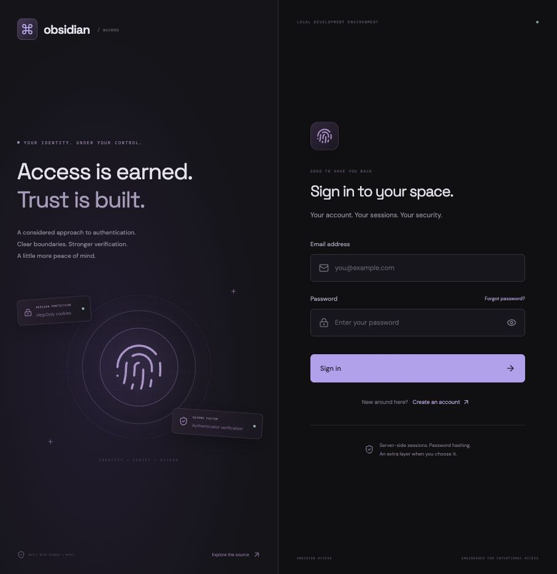
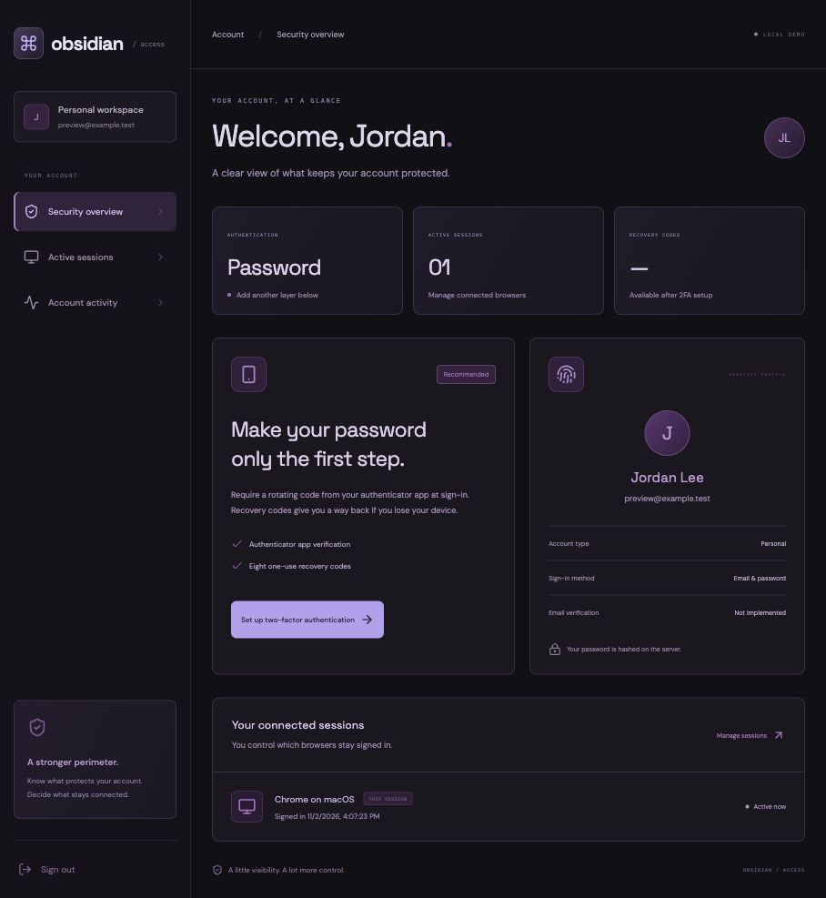

# Obsidian Access

A refreshed Django + React authentication project with a distinct graphite-and-violet interface, server-side sessions, authenticator-based two-factor authentication, recovery codes, password reset, and session revocation.




## Run locally

Requires Python 3.10+ and Node.js 24+. Tested with Python 3.14 and Node 25.

```sh
python3 -m venv .venv
source .venv/bin/activate
pip install -r requirements.txt
python manage.py migrate
python manage.py runserver 127.0.0.1:8004 --noreload
```

In a second terminal:

```sh
cd react_auth
npm ci
npm start
```

Open **http://localhost:5177**. Vite proxies `/api` to Django. Use localhost for the frontend: it is the configured trusted origin. Create a local account with a password of 12–128 characters. No sample accounts or passwords are committed.

## Authentication features

- Email/password registration and login with Django password hashing and validation.
- Database-backed, HttpOnly, SameSite=Strict session cookies; no bearer tokens in browser storage.
- CSRF bootstrap and protection on every state-changing API request, including login.
- Authenticator-app TOTP enrollment, confirmed with a code before enabling.
- Current-password verification before revealing a setup key or disabling two-factor authentication.
- Eight cryptographically random recovery codes, shown once and stored only as SHA-256 digests.
- Rejection of replayed authenticator codes and previously consumed recovery codes.
- Five-minute pending login challenges; full authentication requires the second factor.
- Individual session revocation, with owner checks, plus a recent security-event feed.
- One-hour password reset links using Django's token generator. Reset revokes sessions and invalidates pending login challenges; it does not disable MFA.
- Enabling two-factor authentication revokes other tracked sessions.
- IP-based rate limits on credential, reset, and MFA endpoints (15 attempts per action per five minutes).

TOTP enrollment uses a **manual setup key**, not a QR code. Add a time-based account in a compatible authenticator app, enter the key, and confirm a current six-digit code. Setup expires after five minutes. Codes allow one time step of clock drift; once a code is consumed, wait for the next code before reusing that factor. Recovery codes work alongside the password, not as password replacements.

## Password reset in the local demo

The default Django console email backend prints reset links to the backend terminal. No email is sent externally. The frontend always returns a generic account-existence response. Open the printed link and choose a new password. If MFA was enabled, it remains required at the next login.

Email verification, OAuth/social login, passkeys, SMS, QR enrollment, recovery-code regeneration, and production email delivery are **not implemented**. The interface does not claim otherwise. If all MFA factors are lost, there is no administrative account-recovery flow in this demo.

## Configuration and data

- SQLite, sessions, and an automatically generated development key live in ignored `data/`.
- `DJANGO_SECRET_KEY` overrides the local key. A stable key is essential: it signs sessions/reset tokens and derives the Fernet key used to encrypt TOTP secrets. Keep it confidential and back it up with the database. Changing it invalidates sessions/reset links and prevents existing TOTP secrets from being decrypted without a migration.
- `DJANGO_DEBUG` defaults to `1`; `0` enables Secure cookies, which require HTTPS.
- `FRONTEND_ORIGIN` defaults to `http://localhost:5177` and determines trusted CSRF origin and reset-link origin.
- Session lifetime is 24 hours. Sessions are revoked on password reset; browser labels are inferred from the user-agent and are not verified device identities.

This replaces the former hard-coded JWT signing secret and permissive CORS setup. The React frontend now uses Vite; the API remains Django. Existing user model and initial migration are retained. The default database is now SQLite for portable local setup; a previous external MySQL database is not automatically migrated or modified.

## Checks

```sh
python manage.py check
python manage.py test
cd react_auth && npm run build
```

Tests exercise password policy, generic login errors, session authentication/logout, CSRF and trusted origins, mandatory MFA, TOTP replay, one-use recovery, enrollment confirmation, session owner isolation, reset-token reuse, pending-challenge invalidation, MFA disable verification, and throttling.

## Before hosting

This is a local portfolio implementation, not an audited identity provider. Add production HTTPS, explicit allowed hosts, a managed secret/encryption-key strategy, production email configuration, shared rate-limit storage, stronger abuse controls and monitoring, retention/cleanup jobs for sessions/events, deployment/static hosting, and a security review. Rate limiting currently uses local memory and is per process. SQLite is used locally; validate concurrent security transitions against a production database before scaling. CAS updates protect individual factor consumption, but broader multi-request account transitions need production concurrency review. MFA secrets are encrypted with a key derived from the Django secret, rather than a separately managed KMS key.

The API exposes no live email sender or external authentication integration by default. The frontend fetches Google Fonts and has local font fallbacks.

References: [Django authentication](https://docs.djangoproject.com/en/5.2/topics/auth/default/) and [PyOTP](https://pyauth.github.io/pyotp/).
